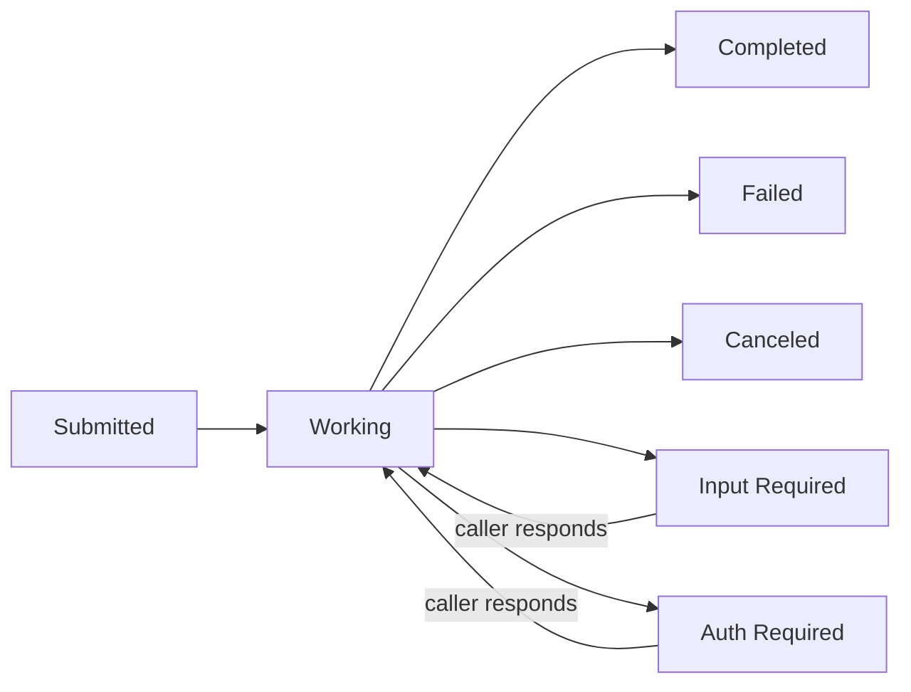

# The A2A primer

The minimum vocabulary you need to read the rest of these docs. This page is deliberately narrow: for anything beyond it, see the official A2A specification.

## Message and Parts

A `Message` is what a caller sends and an agent replies with. Its content is one or more typed `Part`s, not a single blob:

- `TextPart` — plain text.
- `DataPart` — a JSON object, for structured input or output.
- `FilePart` — a file, by URI or inline bytes.

A message can carry several parts of different kinds at once — the part itself carries its type, so there is no separate content-type field to keep in sync with it.

## Task and TaskState

Sending a message to an agent creates (or continues) a `Task` — A2A's unit of work. A task moves through a `TaskState`, and the states split into two sets:

- **Terminal** — the task will not change again: `COMPLETED`, `FAILED`, `CANCELED`, `REJECTED`.
- **Interrupt** — the task has paused and will resume once the caller supplies something: `INPUT_REQUIRED`, `AUTH_REQUIRED`.

Both sets stop a stream, but they are not the same thing: a stream that ends on `INPUT_REQUIRED` is over *and* unfinished — not failed, not abandoned. A stream that ends on neither set is a different case again: a transport failure wearing the shape of a completed run, not a real outcome.

## Artifact

An `Artifact` is a task's typed, named output — what the agent produced, as distinct from `status.message`, which is what the agent has to say about *reaching* that state. Like a `Message`, an artifact's content is a list of `Part`s, so a structured result is a real `DataPart`, not JSON packed into a string. An artifact keeps a stable `artifact_id` and a `revision`, so a later update to the same output is recognizable as a new revision rather than a second, unrelated result.

## Agent Card

An Agent Card is how an agent describes itself: its name, the skills it offers, which protocol bindings it speaks, and where it can be reached — a JSON document at the well-known path `/.well-known/agent-card.json`.

On NovaOS, an agent pod does not serve its own card. Pods are never internet-reachable, so the platform's execution gateway publishes `/.well-known/agent-card.json` on the agent's behalf; `AgentBuilder` never adds a route for it. If you're building an agent, `AgentBuilder.to_agent_card()` produces the card *content* for whoever does the publishing — don't expect to see it served by your own process.

## The JSON-RPC methods

Every A2A operation is a JSON-RPC 2.0 call to the agent's endpoint:

- `SendMessage` — send a message, get back a `Task` (or, in the case the spec allows, a bare message).
- `SendStreamingMessage` — the same, but stream status and artifact updates as they happen.
- `GetTask` — fetch one authoritative snapshot of a task.
- `SubscribeToTask` — reconnect to a running task's stream; the first frame is always its current snapshot.
- `ListTasks` — enumerate an agent's tasks, a page at a time.
- `CancelTask` — ask the agent to stop a task; cancellation is a request, so read the state it answers with.
- `CreateTaskPushNotificationConfig`, `GetTaskPushNotificationConfig`, `ListTaskPushNotificationConfigs`, `DeleteTaskPushNotificationConfig` — register or manage a webhook for a task's status changes, instead of holding a stream open or polling.

[`Client`](../reference/api.md#novaos_client_sdk.client) wraps every one of these as a same-named method, in `snake_case`.

## NovaOS metadata rides in DataParts

A2A itself has no field for "which skill should run" or "this task is paused on a human" — those are NovaOS conventions layered on top of the protocol, not new wire fields. Which skill runs travels as `message.metadata["skillId"]`; platform signals like a human-in-the-loop pause travel inside an ordinary `DataPart`, tagged as NovaOS's own in that part's `metadata`. A caller that only reads the base A2A shapes still gets a valid, conformant response — reading the NovaOS-specific fields is what unlocks the platform behavior built on top of it.

## Where to go next

- [Getting started](../getting-started.md)
- [Invoking agents](../guides/invoking-agents.md)
- [Building an agent](../guides/building-an-agent.md)
